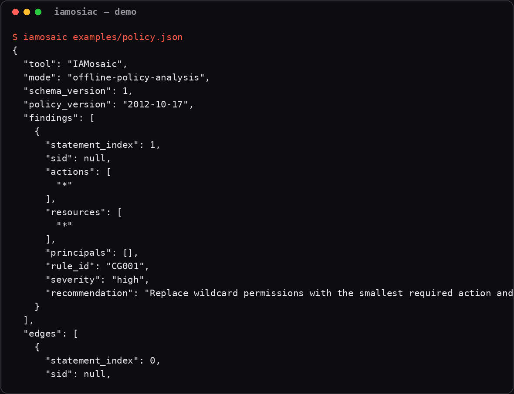

# IAMosaic

[](https://github.com/gravion-ux/iamosiac/actions/workflows/ci.yml)



*Demo: Reviewing an exported IAM policy offline — wildcard and privilege-escalation findings.*

> Offline cloud-IAM policy review and permission-relationship visualization data.

**Status:** MVP scaffold / research prototype. Not production-certified.

## Features
- Parse normalized IAM policy JSON.
- Flag wildcard actions and resources for review.
- Flag wildcard (public) principals and grants by exclusion.
- Emit permission-relationship edges for visualization.
- Provide least-privilege remediation hints.
- Emit a machine-readable JSON report for CI pipelines.

## Rules

| Rule | Detects | Severity |
| --- | --- | --- |
| `CG001` | Wildcard action (`*`) or wildcard resource (`*`) in an `Allow` statement | `high` when both are wildcards, otherwise `medium` |
| `CG002` | Wildcard principal (`*`) in an `Allow` statement | `high` together with a wildcard action or resource, otherwise `medium` |
| `CG003` | `Allow` statement that grants by exclusion (`NotAction` / `NotResource`) | `high` |

`Deny` statements are never reported: they remove permissions instead of granting them.
Every finding carries the `statement_index` of the statement in the exported file, so a
finding can be traced back to the exact statement the analyst sees.

## Quick start

```bash
python -m venv .venv
source .venv/bin/activate
# Windows: .venv\\Scripts\\activate
pip install -e ".[dev]"
pytest
```

## Command line

```bash
iamosaic path/to/policy.json
iamosaic path/to/policy.json --output report.json
iamosaic path/to/policy.json --fail-on-findings
```

| Exit code | Meaning |
| --- | --- |
| `0` | The policy was analyzed and no error occurred |
| `1` | The policy could not be parsed, the report could not be written, or findings were reported with `--fail-on-findings` |
| `2` | The policy file is missing or unreadable |

The report is JSON and carries a `schema_version` field, so downstream tooling can
detect format changes.

## Walkthrough

The repository ships a small synthetic example at `examples/policy.json`. It has two
statements: a scoped `s3:GetObject` grant on one bucket, and a full wildcard grant.

```json
{"Version":"2012-10-17","Statement":[
  {"Effect":"Allow","Action":["s3:GetObject"],"Resource":["arn:aws:s3:::example-bucket/*"]},
  {"Effect":"Allow","Action":"*","Resource":"*"}
]}
```

Running the analyzer on it:

```bash
iamosaic examples/policy.json
```

produces this report (real output, unedited):

```json
{
  "tool": "IAMosaic",
  "mode": "offline-policy-analysis",
  "schema_version": 1,
  "policy_version": "2012-10-17",
  "findings": [
    {
      "statement_index": 1,
      "sid": null,
      "actions": [
        "*"
      ],
      "resources": [
        "*"
      ],
      "principals": [],
      "rule_id": "CG001",
      "severity": "high",
      "recommendation": "Replace wildcard permissions with the smallest required action and resource set."
    }
  ],
  "edges": [
    {
      "statement_index": 0,
      "sid": null,
      "principal": "unspecified",
      "principals": [],
      "action": [
        "s3:GetObject"
      ],
      "not_action": [],
      "resource": [
        "arn:aws:s3:::example-bucket/*"
      ],
      "not_resource": [],
      "effect": "Allow"
    },
    {
      "statement_index": 1,
      "sid": null,
      "principal": "unspecified",
      "principals": [],
      "action": [
        "*"
      ],
      "not_action": [],
      "resource": [
        "*"
      ],
      "not_resource": [],
      "effect": "Allow"
    }
  ],
  "notice": "Findings are review hints that require human validation. No cloud API was contacted and no credential was read."
}
```

Reading the report:

- Only the second statement is flagged: `statement_index` 1, rule `CG001`, severity
  `high` because both the action and the resource are the full wildcard. The scoped
  `s3:GetObject` statement produces no finding.
- The `edges` list still describes **both** statements — findings are the review
  queue, edges are the full permission-relationship picture for visualization.
- In CI, `--fail-on-findings` turns any finding into a failing step:

```console
$ iamosaic examples/policy.json --fail-on-findings   # prints the same report as above
$ echo $?
1
```

## Python API

```python
from iamosaic import analyze_policy, policy_edges, policy_version

findings = analyze_policy(policy)
edges = policy_edges(policy)
version = policy_version(policy)
```

## Architecture

IAMosaic is a single small package under `src/iamosaic/`, with no runtime
dependencies (Python ≥ 3.11, standard library only):

- `analyzer.py` — the rule engine. `_statement_entries` normalizes the policy's
  `Statement` block (a single object or a list; malformed entries are skipped
  while their original indices are preserved). `analyze_policy` applies rules
  CG001–CG003 to every non-`Deny` statement, `policy_edges` emits one
  permission-relationship edge per statement with principals normalized to a
  flat list, and `policy_version` reads the declared policy `Version`.
- `cli.py` — the `iamosaic` command. It loads the exported JSON (tolerating a
  UTF-8 byte-order mark, so Windows exports parse), builds the report
  (`schema_version: 1`), prints it or writes it with `--output`, and maps
  outcomes onto the exit codes above. Load and write failures are reported as
  one-line messages on stderr, never as tracebacks, so the tool drops cleanly
  into CI logs.
- `__init__.py` — re-exports the public API (`analyze_policy`, `policy_edges`,
  `policy_version`, the `CG00x` rule IDs) and the package version.

Tests live in `tests/`: `test_policy.py` covers the three rules and the finding
schema, `test_cli.py` covers the command line and its exit codes, and
`test_parser_edges.py` pins down parser behaviour on empty, malformed,
duplicated and boundary-value input.

## Safety and scope
Offline policy analysis only. No cloud credentials, account access, API calls, or resource modification are performed.

## Roadmap
- [x] Stable public API and versioned report schema
- [ ] More unit, integration and adversarial tests
- [ ] Reproducible benchmarks and sample datasets
- [ ] Signed releases and dependency review
- [x] Documentation and contribution guide

## License
MIT. See [LICENSE](LICENSE).
